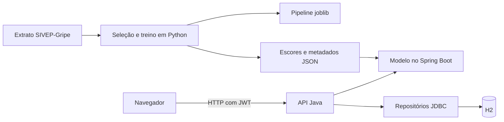

# Manual técnico e de operação · Regulação SRAG

Este manual descreve a entrega integrada da variante A, na branch `EznM/entrega-integrada`. Ele acompanha o percurso de uma notificação desde o estudo retrospectivo até a auditoria de uma predição. A central de regulação é o público simulado. Nas demonstrações, a equipe deve usar fichas fictícias.

## Como obter a versão documentada

Em um computador novo, com Git e JDK 21, use o terminal do VS Code. O primeiro comando baixa a branch que contém a aplicação, o modelo treinado e o vídeo.

```powershell
git clone --branch EznM/entrega-integrada https://github.com/zluisx/srag_ia.git
cd srag_ia
powershell -ExecutionPolicy Bypass -File .\scripts\iniciar.ps1
```

Se já estiver na pasta da entrega, execute apenas a última linha. No primeiro uso, crie uma senha para cada perfil quando solicitado. Após a inicialização, abra http://127.0.0.1:8080 no navegador. As contas padrão são `operador@demo.local` e `gestor@demo.local`. Para configurar outras contas iniciais, endereço ou banco, consulte a tabela de variáveis no [README](../README.md).

## O que o sistema estima

A pergunta é se um paciente hospitalizado por SRAG, fora da UTI no dia da admissão, terá uma entrada posterior em UTI na mesma internação. A unidade observada é a notificação. Como a base registra datas sem horário, uma internação em UTI no mesmo dia da admissão não permite estabelecer a ordem dos eventos. Esses casos foram retirados do estudo. A disponibilidade real de leitos e o preenchimento retrospectivo da ficha também influenciam o desfecho.

No extrato do SIVEP-Gripe, 52.932 notificações vieram de UFs do Nordeste. Restaram 13.405 após as regras de seleção. O pipeline agrupou a idade e codificou os sinais; a regressão logística obteve a maior precisão média na validação cruzada entre os candidatos avaliados. O conjunto reservado ao teste continha 2.681 notificações. [Regras e contagens por etapa](qualidade.json) · [Comparação dos modelos e escolha dos limiares](model-card.md)

| Resultado no teste | UTI posterior registrada | Sem UTI posterior registrada |
|---|---:|---:|
| Modelo gerou alerta | 59 | 788 |
| Modelo ficou abaixo do limiar | 54 | 1.780 |

O sistema detectou 59 de 113 eventos (52,2%). Entre os 847 alertas, 59 correspondiam a eventos observados (7,0%). Na apresentação, esses dois denominadores ajudam a explicar por que o protótipo tem finalidade acadêmica e por que a equipe humana continua responsável pela avaliação.

## Arquitetura e persistência



O Python executa o treino offline. Sete faixas etárias e três respostas possíveis para cada um dos seis sinais permitem calcular antecipadamente todas as probabilidades: 7 × 3⁶ = 5.103. O Java carrega os valores e os metadados da mesma versão ao iniciar. O operador precisa conhecer pelo menos um sinal para submeter a ficha. [Treinamento](../scripts/treinar.py) · [Inferência Java](../backend/src/main/java/br/edu/srag/Modelo.java)

| Tabela | O que representa | Relação e comportamento |
|---|---|---|
| `usuarios` | Identidade do operador ou gestor, e-mail, hash da senha e perfil | Um usuário pode cadastrar vários casos e solicitar várias predições. |
| `casos` | Ficha de admissão editável, proprietário e indicador de arquivamento | Cada caso pertence a um usuário. Arquivar retira a ficha da listagem ativa. |
| `predicoes` | Uma execução do modelo, com entrada, resultado, versão, instante e pedido de revisão | Cada execução referencia o caso e o solicitante. Uma segunda análise acrescenta outra linha. |

Ao analisar, o serviço abre uma transação e bloqueia a linha do caso durante a leitura e a gravação da predição. Por isso, é possível editar a ficha depois e ainda recuperar a entrada que produziu cada resultado antigo. O pedido de revisão atualiza o indicador da predição correspondente. O parecer humano segue o procedimento descrito na governança. [Esquema SQL](../backend/src/main/resources/schema.sql) · [Serviço de análises](../backend/src/main/java/br/edu/srag/Analises.java) · [Governança](governanca.md)

## Contrato da API

O prefixo é `/api`. O login recebe JSON com `email` e `senha` e devolve `token`, `perfil` e `email`. Nas chamadas seguintes, envie o cabeçalho `Authorization: Bearer <token>`. O token expira em 30 minutos. O gestor usa as rotas de casos para as próprias fichas e a rota de auditoria para o histórico geral.

| Método e rota após o prefixo | Resultado esperado |
|---|---|
| `POST /login` | 200, sessão autenticada |
| `GET /modelo` | 200, versão, domínios, limiares e métricas |
| `POST /casos` | 201, ficha criada com identificador |
| `GET /casos` e `GET /casos/{id}` | 200, lista ou detalhe de ficha ativa do solicitante |
| `PUT /casos/{id}` | 200, ficha atualizada com a entrada completa |
| `DELETE /casos/{id}` | 204, ficha arquivada |
| `POST /casos/{id}/predicoes` | 201, nova execução com explicação |
| `GET /predicoes` | 200, histórico próprio; parâmetro opcional `caso` |
| `PUT /predicoes/{id}/revisao` | 204, solicitação de revisão registrada |
| `GET /auditoria` | 200 para gestor, com filtros opcionais `email`, `faixa`, `inicio` e `fim` |

Os filtros de data usam `AAAA-MM-DD` e incluem os dias indicados no fuso de São Paulo. O esquema detalha as propriedades obrigatórias e os domínios. Com a aplicação rodando, o Swagger permite executar as operações com o token obtido no login. [Esquema da ficha](esquema-entrada.json) · [Swagger UI local](http://127.0.0.1:8080/swagger-ui.html)

### Exemplo reproduzível

Envie a ficha abaixo em `POST /api/casos`. A faixa 6 corresponde a 80 anos ou mais. Nos sinais, o código `"1"` significa sim, `"2"` significa não e `"9"` significa ignorado.

```json
{
  "idade": 6,
  "sinais": {
    "DISPNEIA": "1",
    "DESC_RESP": "1",
    "SATURACAO": "1",
    "FEBRE": "2",
    "TOSSE": "1",
    "FADIGA": "1"
  }
}
```

Use o `id` devolvido em `POST /api/casos/{id}/predicoes`, com corpo vazio. Para essa ficha, a versão `uti-36737af7c12c` devolve probabilidade de aproximadamente **0,056786**, alerta ativo e faixa **Médio**. A interface apresenta o valor como **5,7%**. Os fatores locais mostram quanto a probabilidade varia, em pontos percentuais, ao trocar uma resposta pela categoria de referência do treino. Para solicitar revisão, use agora o **id da predição** em `PUT /api/predicoes/{id}/revisao`. [Metadados usados no exemplo](../backend/src/main/resources/modelo/metadados.json)

## Diagnóstico de problemas

| Sintoma | Como verificar e resolver |
|---|---|
| O inicializador pede um JDK | Verifique `java -version` e `javac -version`. Configure `JAVA_HOME` para a pasta de um JDK 21 e reabra o terminal. |
| A aplicação inicia, mas a conta recebe 401 | Confira o e-mail e a senha usados na criação da conta. Para uma sessão expirada, entre novamente. Alterar a variável de senha inicial não redefine a senha de uma conta já criada. |
| A análise retorna 400 | Confira se a idade é um índice de 0 a 6, se os seis campos estão presentes e se ao menos um sinal tem resposta conhecida. |
| A auditoria retorna 403 | A consulta geral exige uma sessão de gestor. O operador pode consultar seu próprio histórico em `GET /api/predicoes`. |
| Uma ficha retorna 404 | Confira o identificador, a conta proprietária e se a ficha foi arquivada. As predições anteriores continuam no histórico. |
| A porta 8080 já está ocupada | Escolha outra porta com `$env:SERVER_PORT = '8081'` antes de iniciar e abra o navegador nessa porta. |

## Verificação e entrega

A partir da raiz, com JDK 21 configurado, execute `.\backend\mvnw.cmd -f backend/pom.xml test`. O teste usa HTTP e H2 em memória. Ele verifica acesso por perfil, entradas inválidas, propriedade da ficha e preservação do histórico depois da edição e do arquivamento. [Teste de integração](../backend/src/test/java/br/edu/srag/FluxoTest.java)

Para apresentar, mostre a ficha acima, solicite a revisão como operador e localize o pedido como gestor. Termine na tela **Transparência**, explicando a diferença entre sensibilidade e precisão com os números do teste. O vídeo registra esse percurso. [Demonstração](demonstracao.mp4)

| Frente do trabalho | Evidência para a equipe e a banca |
|---|---|
| IA e explicabilidade | [Model card](model-card.md), [pipeline treinado](../modelo/pipeline.joblib) e [importância global](../backend/src/main/resources/modelo/metadados.json) |
| Governança e qualidade | [Catálogo, papéis, controles e retenção](governanca.md), [destino das 194 colunas](destino-colunas.tsv) e [relatório de qualidade](qualidade.json) |
| Back-end e integração | [Rotas REST](../backend/src/main/java/br/edu/srag/Api.java), [controle de acesso](../backend/src/main/java/br/edu/srag/Seguranca.java) e [persistência](../backend/src/main/java/br/edu/srag/Registros.java) |
| Execução e reprodução | [README com configuração, treinamento, fontes e declaração de uso de IA](../README.md) |

Para a entrega formal, cabe ao grupo conferir os nomes e as contribuições dos integrantes, identificar a branch ou o commit entregue e realizar a submissão na Plataforma A.
